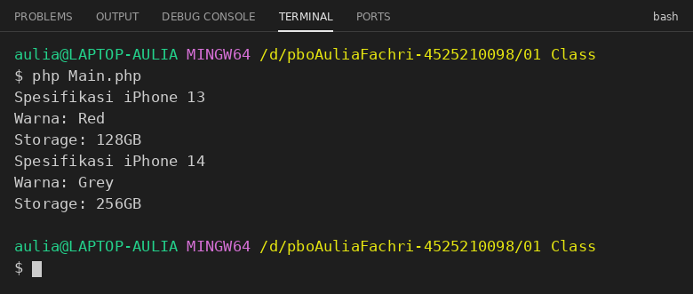
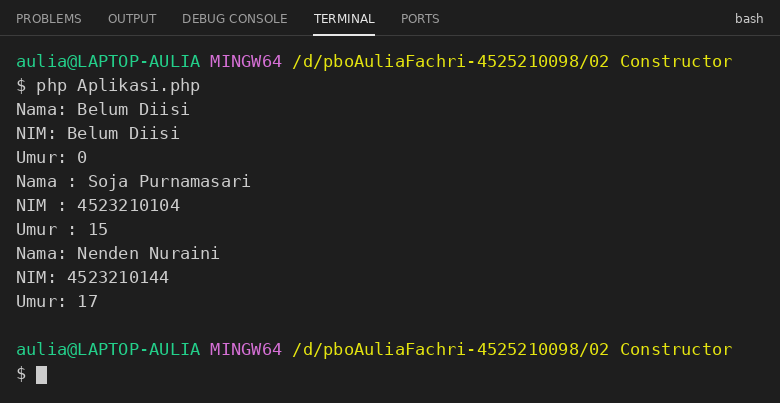
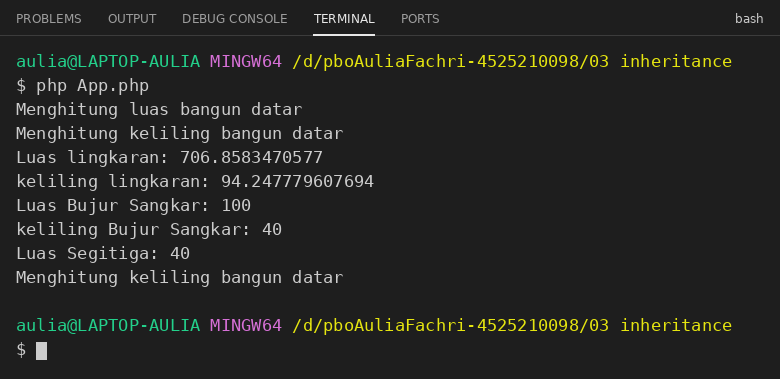
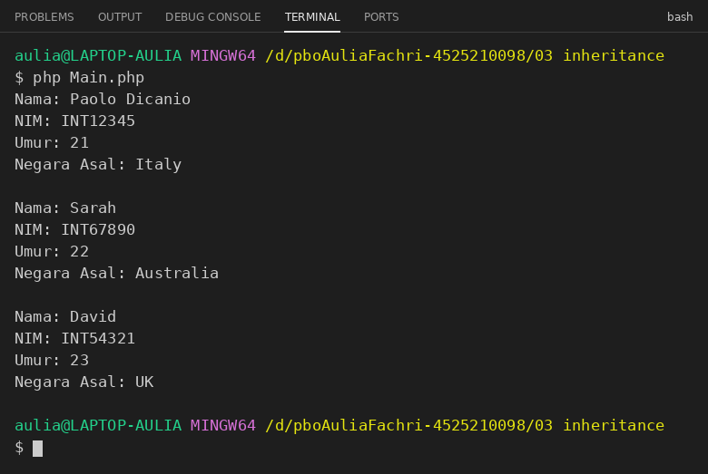
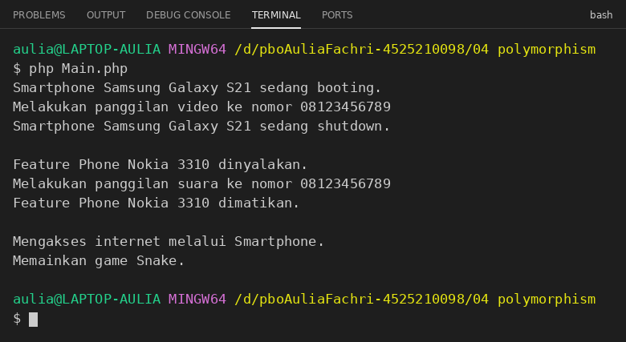
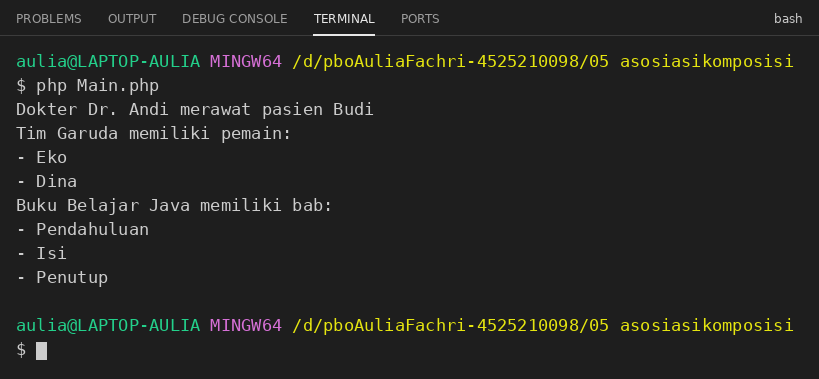
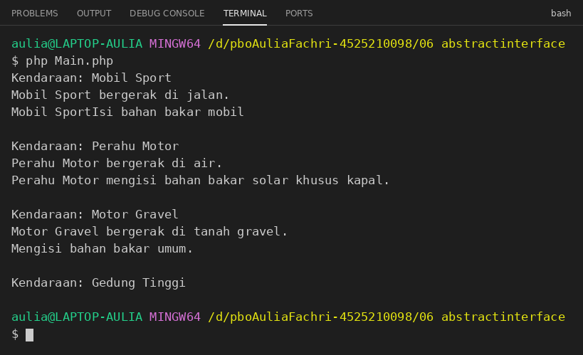

# Laporan Praktikum Pemrograman Berorientasi Objek (PBO)

| | |
|---|---|
| **Nama** | Aulia Fachri |
| **NIM** | 4525210098 |
| **Program Studi** | Teknik Informatika |

## Deskripsi

Laporan ini berisi hasil konversi seluruh program PBO dari bahasa Java ke PHP, mencakup enam pokok bahasan: Class, Constructor, Inheritance, Polymorphism, Asosiasi/Agregasi/Komposisi, serta Abstract Class dan Interface. Sintaks dibuat sesederhana mungkin dan mengikuti struktur program Java aslinya.

## Cara Menjalankan

Pastikan PHP 7.4 atau lebih baru sudah terpasang (`php -v`), lalu masuk ke folder bab yang ingin dijalankan dan jalankan file utamanya lewat terminal:

```bash
cd "01 Class"
php Main.php
```

File utama tiap bab: `Main.php` (bab 01, 03, 04, 05, 06), `Aplikasi.php` (bab 02), dan `App.php` (bab 03, contoh bangun datar).

## Perbedaan Java dan PHP yang Ditangani

| Java | PHP |
|---|---|
| `System.out.println(...)` | `echo ... . PHP_EOL;` |
| Penggabungan string dengan `+` | Penggabungan string dengan `.` |
| `this.nama` | `$this->nama` |
| Constructor bernama sama dengan class | `__construct()` |
| Constructor overloading | Satu constructor dengan parameter default |
| `super(...)` / `super.method()` | `parent::__construct(...)` / `parent::method()` |
| `ArrayList` / `Arrays.asList` | Array `[]` |
| `interface` dengan `default` method | `interface` untuk kontrak dan `trait` untuk isi default |
| `implements A, B` | `implements A` ditambah `use B;` untuk trait |

---

## Bab 1. Class dan Object

### Dasar Teori

Class adalah cetak biru (blueprint) untuk membuat object, berisi properties (data) dan method (perilaku). Object dibuat dari class dengan kata kunci `new` (instansiasi). Pada percobaan ini dibuat class `iPhone` dengan properties `color` dan `storage`, constructor `__construct()`, serta getter `getColor()` dan `getStorage()`.

### Source Code

**`01 Class/iPhone.php`**

```php
<?php
class iPhone {
    // Properties
    /*
     * warna/color
     * storage/kapasistas penyimpanan
     */
    public $color;
    public $storage;

    // Methods
    /*
     * 1. Konstraktor() --> di PHP namanya __construct()
     * 2. getColor()
     * 3. getStorage()
     */

    // Konstraktor
    /*
     * jadi setiap objek yang dibentuk dari class harus memberikan nilai/value
     * terhadap beberapa properties
     */
    public function __construct($color, $storage) {
        $this->color = $color;
        $this->storage = $storage;
    }

    // public -> bisa diakses dari umum
    // getColor() --> adalah nama method
    // return --> karena method punya keluaran/output, maka di dalam method harus
    // menggunakan return supaya punya keluaran/output.
    public function getColor() {
        return $this->color;
    }

    public function getStorage() {
        return $this->storage;
    }
}
```

**`01 Class/Main.php`**

```php
<?php
require_once 'iPhone.php';

// membuat object iPhone dari class iPhone
$iphone13 = new iPhone("Red", "128GB"); // proses inisiasi atau instantiation
$iphone14 = new iPhone("Grey", "256GB"); // proses inisiasi atau instantiation

echo "Spesifikasi iPhone 13" . PHP_EOL;
echo "Warna: " . $iphone13->getColor() . PHP_EOL;
echo "Storage: " . $iphone13->getStorage() . PHP_EOL;

echo "Spesifikasi iPhone 14" . PHP_EOL;
echo "Warna: " . $iphone14->getColor() . PHP_EOL;
echo "Storage: " . $iphone14->getStorage() . PHP_EOL;
```

### Hasil Running

Perintah: `php Main.php` (folder `01 Class`)



### Analisis

Dua object (`$iphone13` dan `$iphone14`) dibuat dari class yang sama dengan nilai properties berbeda, lalu spesifikasinya ditampilkan lewat getter.

---

## Bab 2. Constructor

### Dasar Teori

Constructor adalah method khusus yang otomatis dipanggil saat object dibuat. Di Java constructor bisa di-overload (beberapa constructor dengan parameter berbeda), sedangkan PHP hanya mengizinkan satu `__construct()`, sehingga overloading diganti dengan parameter default. Class `Mahasiswa` memakai `private` properties beserta getter dan setter.

### Source Code

**`02 Constructor/Mahasiswa.php`**

```php
<?php
// Kelas Mahasiswa dengan constructor (default parameter), setter, dan getter
class Mahasiswa {

    // Variabel instance
    private $nama;
    private $nim;
    private $umur;

    // PHP tidak punya constructor overloading, jadi 3 constructor di Java
    // digabung jadi 1 constructor dengan nilai default:
    // new Mahasiswa()                      --> semua pakai nilai default
    // new Mahasiswa("Budi", "12345678")    --> umur default 0
    // new Mahasiswa("Siti", "87654321", 22)
    public function __construct($nama = "Belum Diisi", $nim = "Belum Diisi", $umur = 0) {
        $this->nama = $nama;
        $this->nim = $nim;
        $this->umur = $umur;
    }

    // Getter dan Setter untuk nama
    public function getNama() {
        return $this->nama;
    }

    public function setNama($nama) {
        $this->nama = $nama;
    }

    // Getter dan Setter untuk nim
    public function getNim() {
        return $this->nim;
    }

    public function setNim($nim) {
        $this->nim = $nim;
    }

    // Getter dan Setter untuk umur
    public function getUmur() {
        return $this->umur;
    }

    public function setUmur($umur) {
        $this->umur = $umur;
    }

    // Method untuk menampilkan informasi mahasiswa
    public function tampilkanInfo() {
        echo "Nama: " . $this->nama . PHP_EOL;
        echo "NIM: " . $this->nim . PHP_EOL;
        echo "Umur: " . $this->umur . PHP_EOL;
    }
}
```

**`02 Constructor/Aplikasi.php`**

```php
<?php
// File utama untuk menjalankan program
require_once 'Mahasiswa.php';

// // Menggunakan constructor tanpa parameter
// $mhs1 = new Mahasiswa();
// $mhs1->tampilkanInfo();

// echo PHP_EOL;

// // Menggunakan constructor dengan 2 parameter
// $mhs2 = new Mahasiswa("Budi", "12345678");
// $mhs2->setUmur(20); // Mengatur umur menggunakan setter
// $mhs2->tampilkanInfo();

// echo PHP_EOL;

// // Menggunakan constructor dengan 3 parameter
// $mhs3 = new Mahasiswa("Siti", "87654321", 22);
// $mhs3->tampilkanInfo();

$soja = new Mahasiswa();
$soja->tampilkanInfo();

// memberikan value Soja Purnamasari ke property nama dari objek soja
$soja->setNama("Soja Purnamasari");
echo "Nama : " . $soja->getNama() . PHP_EOL;

$soja->setNim("4523210104");
echo "NIM : " . $soja->getNim() . PHP_EOL;

$soja->setUmur(15);
echo "Umur : " . $soja->getUmur() . PHP_EOL;

// Constructor lengkap
$nenden = new Mahasiswa("Nenden Nuraini", "4523210144", 17);
$nenden->tampilkanInfo();
```

### Hasil Running

Perintah: `php Aplikasi.php` (folder `02 Constructor`)



### Analisis

`$soja` dibuat tanpa argumen sehingga berisi nilai default ("Belum Diisi", umur 0), lalu diisi lewat setter. `$nenden` dibuat langsung dengan tiga argumen.

---

## Bab 3. Inheritance (Pewarisan)

### Dasar Teori

Inheritance memungkinkan class turunan (child) mewarisi properties dan method dari class induk (parent) dengan kata kunci `extends`. Child dapat meng-override method parent dan memanggil versi parent dengan `parent::`. Ada dua contoh: `BangunDatar` dengan turunan `Lingkaran`, `Persegi`, `Segitiga`; serta `Mahasiswa` dengan turunan `MahasiswaInternational`.

### Source Code

**`03 inheritance/BangunDatar.php`**

```php
<?php
class BangunDatar {
    /**
     * tidak ada properties karena turunan dari BangunDatar
     * punya nama properties yang berbeda-beda
     */

    // method untuk menghitung luas bangun datar
    public function luas() {
        echo "Menghitung luas bangun datar" . PHP_EOL;
        return 0;
    }

    // method untuk menghitung keliling bangun datar
    public function keliling() {
        echo "Menghitung keliling bangun datar" . PHP_EOL;
        return 0;
    }
}
```

**`03 inheritance/Lingkaran.php`**

```php
<?php
require_once 'BangunDatar.php';

class Lingkaran extends BangunDatar {
    // r atau jari-jari
    private $r;

    public function __construct($r) {
        $this->r = $r;
    }

    public function luas() {
        return M_PI * $this->r * $this->r;
    }

    public function keliling() {
        return 2 * M_PI * $this->r;
    }
}
```

**`03 inheritance/Persegi.php`**

```php
<?php
require_once 'BangunDatar.php';

class Persegi extends BangunDatar {
    private $sisi;

    public function __construct($sisi) {
        $this->sisi = $sisi;
    }

    public function luas() {
        return $this->sisi * $this->sisi;
    }

    public function keliling() {
        return $this->sisi * 4;
    }
}
```

**`03 inheritance/Segitiga.php`**

```php
<?php
require_once 'BangunDatar.php';

class Segitiga extends BangunDatar {
    private $alas;
    private $tinggi;

    public function __construct($alas, $tinggi) {
        $this->alas = $alas;
        $this->tinggi = $tinggi;
    }

    public function luas() {
        return ($this->alas * $this->tinggi) / 2;
    }
}
```

**`03 inheritance/App.php`**

```php
<?php
require_once 'BangunDatar.php';
require_once 'Lingkaran.php';
require_once 'Persegi.php';
require_once 'Segitiga.php';

$bd = new BangunDatar();

$bd->luas();
$bd->keliling();

// instantiate / membuat objek lingkaran
$lk = new Lingkaran(15);
echo "Luas lingkaran: " . $lk->luas() . PHP_EOL;
echo "keliling lingkaran: " . $lk->keliling() . PHP_EOL;

// instantiate / membuat objek Persegi
$pj = new Persegi(10);
echo "Luas Bujur Sangkar: " . $pj->luas() . PHP_EOL;
echo "keliling Bujur Sangkar: " . $pj->keliling() . PHP_EOL;

// instantiate / membuat objek segitiga
$sg = new Segitiga(10, 8);
echo "Luas Segitiga: " . $sg->luas() . PHP_EOL;

// karena class Segitiga tidak mendefinisikan keliling
// maka ketika sg memanggil keliling(), yang terpanggil
// adalah keliling() yang ada di parent/super class yaitu
// BangunDatar
$sg->keliling();
// echo "keliling Segitiga: " . $sg->keliling() . PHP_EOL;
```

**`03 inheritance/Mahasiswa.php`**

```php
<?php
// Kelas Mahasiswa (Parent Class)
class Mahasiswa {

    // Variabel instance
    private $nama;
    private $nim;
    private $umur;

    // PHP tidak punya constructor overloading, jadi 3 constructor di Java
    // digabung jadi 1 constructor dengan nilai default:
    // new Mahasiswa()                      --> semua pakai nilai default
    // new Mahasiswa("Budi", "12345678")    --> umur default 0
    // new Mahasiswa("Siti", "87654321", 22)
    public function __construct($nama = "Belum Diisi", $nim = "Belum Diisi", $umur = 0) {
        $this->nama = $nama;
        $this->nim = $nim;
        $this->umur = $umur;
    }

    // Getter dan Setter untuk nama
    public function getNama() {
        return $this->nama;
    }

    public function setNama($nama) {
        $this->nama = $nama;
    }

    // Getter dan Setter untuk nim
    public function getNim() {
        return $this->nim;
    }

    public function setNim($nim) {
        $this->nim = $nim;
    }

    // Getter dan Setter untuk umur
    public function getUmur() {
        return $this->umur;
    }

    public function setUmur($umur) {
        $this->umur = $umur;
    }

    // Method untuk menampilkan informasi mahasiswa
    public function tampilkanInfo() {
        echo "Nama: " . $this->nama . PHP_EOL;
        echo "NIM: " . $this->nim . PHP_EOL;
        echo "Umur: " . $this->umur . PHP_EOL;
    }
}
```

**`03 inheritance/MahasiswaInternational.php`**

```php
<?php
require_once 'Mahasiswa.php';

// Kelas MahasiswaInternational (Subclass) yang mewarisi Mahasiswa
class MahasiswaInternational extends Mahasiswa {
    // Variabel tambahan untuk mahasiswa internasional
    private $negaraAsal;

    // 1 constructor dengan nilai default (pengganti 3 constructor di Java)
    public function __construct($nama = "Belum Diisi", $nim = "Belum Diisi", $umur = 0, $negaraAsal = "Belum Diisi") {
        parent::__construct($nama, $nim, $umur); // Memanggil constructor parent
        $this->negaraAsal = $negaraAsal;
    }

    // Getter dan Setter untuk negara asal
    public function getNegaraAsal() {
        return $this->negaraAsal;
    }

    public function setNegaraAsal($negaraAsal) {
        $this->negaraAsal = $negaraAsal;
    }

    // Override method tampilkanInfo untuk menampilkan informasi tambahan
    public function tampilkanInfo() {
        parent::tampilkanInfo(); // Memanggil method tampilkanInfo dari parent
        echo "Negara Asal: " . $this->negaraAsal . PHP_EOL;
    }
}
```

**`03 inheritance/Main.php`**

```php
<?php
// File utama untuk menjalankan program
require_once 'MahasiswaInternational.php';

// Menggunakan constructor tanpa parameter di MahasiswaInternational
$mhsInt1 = new MahasiswaInternational();
$mhsInt1->setNama("Paolo Dicanio");
$mhsInt1->setNim("INT12345");
$mhsInt1->setUmur(21);
$mhsInt1->setNegaraAsal("Italy");
$mhsInt1->tampilkanInfo();

echo PHP_EOL;

// Menggunakan constructor dengan nama, nim, umur (0 dulu), dan negara
$mhsInt2 = new MahasiswaInternational("Sarah", "INT67890", 0, "Australia");
$mhsInt2->setUmur(22); // Mengatur umur menggunakan setter
$mhsInt2->tampilkanInfo();

echo PHP_EOL;

// Menggunakan constructor dengan 4 parameter (nama, nim, umur, negara)
$mhsInt3 = new MahasiswaInternational("David", "INT54321", 23, "UK");
$mhsInt3->tampilkanInfo();
```

### Hasil Running

Perintah: `php App.php` (folder `03 inheritance`)



Perintah: `php Main.php` (folder `03 inheritance`)



### Analisis

Pada `App.php`, `Segitiga` tidak mendefinisikan `keliling()`, sehingga yang dipanggil adalah `keliling()` milik parent `BangunDatar`. Pada `Main.php`, `tampilkanInfo()` di-override untuk menambahkan baris negara asal setelah memanggil `parent::tampilkanInfo()`.

---

## Bab 4. Polymorphism

### Dasar Teori

Polymorphism berarti satu pemanggilan method dapat menghasilkan perilaku berbeda tergantung object yang memanggilnya. `Smartphone` dan `FeaturePhone` sama-sama turunan `Handphone` dan masing-masing meng-override `nyalakan()`, `matikan()`, dan `telepon()`. Method khusus tiap class dipanggil setelah dicek dengan `instanceof`.

### Source Code

**`04 polymorphism/Handphone.php`**

```php
<?php
class Handphone {
    protected $merk;
    protected $model;

    public function __construct($merk, $model) {
        $this->merk = $merk;
        $this->model = $model;
    }

    public function nyalakan() {
        echo "Handphone dinyalakan." . PHP_EOL;
    }

    public function matikan() {
        echo "Handphone dimatikan." . PHP_EOL;
    }

    public function telepon($nomor) {
        echo "Memanggil nomor " . $nomor . PHP_EOL;
    }
}
```

**`04 polymorphism/Smartphone.php`**

```php
<?php
require_once 'Handphone.php';

class Smartphone extends Handphone {

    public function __construct($merk, $model) {
        parent::__construct($merk, $model);
    }

    public function nyalakan() {
        echo "Smartphone " . $this->merk . " " . $this->model . " sedang booting." . PHP_EOL;
    }

    public function matikan() {
        echo "Smartphone " . $this->merk . " " . $this->model . " sedang shutdown." . PHP_EOL;
    }

    public function telepon($nomor) {
        echo "Melakukan panggilan video ke nomor " . $nomor . PHP_EOL;
    }

    public function aksesInternet() {
        echo "Mengakses internet melalui Smartphone." . PHP_EOL;
    }
}
```

**`04 polymorphism/FeaturePhone.php`**

```php
<?php
require_once 'Handphone.php';

class FeaturePhone extends Handphone {

    public function __construct($merk, $model) {
        parent::__construct($merk, $model);
    }

    public function nyalakan() {
        echo "Feature Phone " . $this->merk . " " . $this->model . " dinyalakan." . PHP_EOL;
    }

    public function matikan() {
        echo "Feature Phone " . $this->merk . " " . $this->model . " dimatikan." . PHP_EOL;
    }

    public function telepon($nomor) {
        echo "Melakukan panggilan suara ke nomor " . $nomor . PHP_EOL;
    }

    public function mainGameSnake() {
        echo "Memainkan game Snake." . PHP_EOL;
    }
}
```

**`04 polymorphism/Main.php`**

```php
<?php
require_once 'Smartphone.php';
require_once 'FeaturePhone.php';

// Membuat array dari Handphone
$daftarHandphone = [];

// Mengisi array dengan objek Smartphone dan FeaturePhone
$daftarHandphone[0] = new Smartphone("Samsung", "Galaxy S21");
$daftarHandphone[1] = new FeaturePhone("Nokia", "3310");

// Menggunakan loop untuk memanggil metode secara polimorfik
foreach ($daftarHandphone as $hp) {
    $hp->nyalakan();
    $hp->telepon("08123456789");
    $hp->matikan();
    echo PHP_EOL;
}

// Mengakses metode khusus (cek tipe dengan instanceof)
foreach ($daftarHandphone as $hp) {
    if ($hp instanceof Smartphone) {
        $hp->aksesInternet();
    } elseif ($hp instanceof FeaturePhone) {
        $hp->mainGameSnake();
    }
}
```

### Hasil Running

Perintah: `php Main.php` (folder `04 polymorphism`)



### Analisis

Perulangan pertama memanggil method yang sama pada tiap object, tetapi keluarannya berbeda sesuai class aslinya. Perulangan kedua memanggil `aksesInternet()` khusus Smartphone dan `mainGameSnake()` khusus FeaturePhone.

---

## Bab 5. Asosiasi, Agregasi, dan Komposisi

### Dasar Teori

Asosiasi: dua class saling berhubungan tanpa kepemilikan (`Dokter` merawat `Pasien`). Agregasi: hubungan "memiliki" yang lemah, bagian tetap bisa hidup tanpa keseluruhan (`Tim` memiliki `Pemain` yang dibuat di luar). Komposisi: hubungan "memiliki" yang kuat, bagian dibuat dan dimiliki oleh keseluruhan (`Buku` membuat sendiri `Bab` di dalamnya).

### Source Code

**`05 asosiasikomposisi/Dokter.php`**

```php
<?php
require_once 'Pasien.php';

class Dokter {
    private $nama;

    public function __construct($nama) {
        $this->nama = $nama;
    }

    public function merawat(Pasien $pasien) {
        echo "Dokter " . $this->nama . " merawat pasien " . $pasien->getNama() . PHP_EOL;
    }
}
```

**`05 asosiasikomposisi/Pasien.php`**

```php
<?php
class Pasien {
    private $nama;

    public function __construct($nama) {
        $this->nama = $nama;
    }

    public function getNama() {
        return $this->nama;
    }
}
```

**`05 asosiasikomposisi/Pemain.php`**

```php
<?php
class Pemain {
    private $nama;

    public function __construct($nama) {
        $this->nama = $nama;
    }

    public function getNama() {
        return $this->nama;
    }
}
```

**`05 asosiasikomposisi/Tim.php`**

```php
<?php
require_once 'Pemain.php';

class Tim {
    private $namaTim;
    private $daftarPemain;

    public function __construct($namaTim, $daftarPemain) {
        $this->namaTim = $namaTim;
        $this->daftarPemain = $daftarPemain;
    }

    public function tampilkanPemain() {
        echo "Tim " . $this->namaTim . " memiliki pemain:" . PHP_EOL;
        foreach ($this->daftarPemain as $pemain) {
            echo "- " . $pemain->getNama() . PHP_EOL;
        }
    }
}
```

**`05 asosiasikomposisi/Bab.php`**

```php
<?php
class Bab {
    private $judulBab;

    public function __construct($judulBab) {
        $this->judulBab = $judulBab;
    }

    public function getJudulBab() {
        return $this->judulBab;
    }
}
```

**`05 asosiasikomposisi/Buku.php`**

```php
<?php
require_once 'Bab.php';

class Buku {
    private $judulBuku;
    private $daftarBab;

    public function __construct($judulBuku) {
        $this->judulBuku = $judulBuku;
        $this->daftarBab = [];
        $this->tambahBab();
    }

    private function tambahBab() {
        $this->daftarBab[] = new Bab("Pendahuluan");
        $this->daftarBab[] = new Bab("Isi");
        $this->daftarBab[] = new Bab("Penutup");
    }

    public function tampilkanBab() {
        echo "Buku " . $this->judulBuku . " memiliki bab:" . PHP_EOL;
        foreach ($this->daftarBab as $bab) {
            echo "- " . $bab->getJudulBab() . PHP_EOL;
        }
    }
}
```

**`05 asosiasikomposisi/Main.php`**

```php
<?php
require_once 'Dokter.php';
require_once 'Pasien.php';
require_once 'Pemain.php';
require_once 'Tim.php';
require_once 'Buku.php';

/**
 * ASOSIASI
 */
// object dokter
$dokter = new Dokter("Dr. Andi");
// object pasien
$pasien = new Pasien("Budi");

// asosiasi. Pak Dokter merawat Pasien
$dokter->merawat($pasien);

/**
 * AGREGASI
 */
// object Pemain Eko
$pemain1 = new Pemain("Eko");
// object Pemain Diana
$pemain2 = new Pemain("Dina");

// Membuat Tim
$tim = new Tim("Garuda", [$pemain1, $pemain2]);
$tim->tampilkanPemain();

/**
 * KOMPOSISI
 */
// object Buku
$buku = new Buku("Belajar Java");
$buku->tampilkanBab();
// Jika buku dihancurkan, bab juga ikut hilang
$buku = null;
```

### Hasil Running

Perintah: `php Main.php` (folder `05 asosiasikomposisi`)



### Analisis

Dokter merawat pasien (asosiasi), tim menampilkan daftar pemain yang dikirim dari luar (agregasi), dan buku menampilkan tiga bab yang dibuat di dalam constructor-nya (komposisi). Saat `$buku = null`, bab-bab tersebut ikut tidak bisa diakses lagi.

---

## Bab 6. Abstract Class dan Interface

### Dasar Teori

Abstract class (`Vehicle`) tidak bisa diinstansiasi langsung dan menjadi dasar bagi class turunannya. Interface (`Movable`) menentukan kontrak method yang wajib diimplementasikan. Karena PHP tidak mendukung default method pada interface, `Fuelable` dibuat sebagai `trait` yang menyediakan `refuel()` default dan dipakai dengan `use`.

### Source Code

**`06 abstractinterface/Vehicle.php`**

```php
<?php
// Abstract class
abstract class Vehicle {
    protected $name;

    public function __construct($name) {
        $this->name = $name;
    }

    // Method umum yang bisa digunakan semua kendaraan
    public function showInfo() {
        echo "Kendaraan: " . $this->name . PHP_EOL;
    }
}
```

**`06 abstractinterface/Movable.php`**

```php
<?php
// Interface yang menentukan kontrak bahwa kendaraan bisa bergerak
interface Movable {
    public function move(); // Semua kendaraan harus bisa bergerak
}
```

**`06 abstractinterface/Fuelable.php`**

```php
<?php
// PHP interface tidak bisa punya default method, jadi Fuelable dibuat
// sebagai trait supaya method refuel() tetap punya isi default.
trait Fuelable {
    public function refuel() {
        echo "Mengisi bahan bakar umum." . PHP_EOL;
    }
}
```

**`06 abstractinterface/Car.php`**

```php
<?php
require_once 'Vehicle.php';
require_once 'Movable.php';
require_once 'Fuelable.php';

// Subclass dari Vehicle yang mengimplementasikan Movable dan Fuelable
class Car extends Vehicle implements Movable {
    use Fuelable;

    public function __construct($name) {
        parent::__construct($name);
    }

    // Implementasi method move() dari Movable
    public function move() {
        echo $this->name . " bergerak di jalan." . PHP_EOL;
    }

    // Override refuel() dari Fuelable
    public function refuel() {
        echo $this->name . "Isi bahan bakar mobil" . PHP_EOL;
    }
}
```

**`06 abstractinterface/Boat.php`**

```php
<?php
require_once 'Vehicle.php';
require_once 'Movable.php';
require_once 'Fuelable.php';

// Subclass lain dari Vehicle yang mengimplementasikan Movable dan Fuelable
class Boat extends Vehicle implements Movable {
    use Fuelable;

    public function __construct($name) {
        parent::__construct($name);
    }

    // Implementasi method move() dari Movable
    public function move() {
        echo $this->name . " bergerak di air." . PHP_EOL;
    }

    // Override refuel() dari Fuelable
    public function refuel() {
        echo $this->name . " mengisi bahan bakar solar khusus kapal." . PHP_EOL;
    }
}
```

**`06 abstractinterface/Motor.php`**

```php
<?php
require_once 'Vehicle.php';
require_once 'Movable.php';
require_once 'Fuelable.php';

class Motor extends Vehicle implements Movable {
    use Fuelable; // refuel() memakai versi default dari Fuelable

    public function __construct($name) {
        parent::__construct($name);
    }

    // Implementasi method move() dari Movable
    public function move() {
        echo $this->name . " bergerak di tanah gravel." . PHP_EOL;
    }
}
```

**`06 abstractinterface/Building.php`**

```php
<?php
require_once 'Vehicle.php';

// Subclass dari Vehicle yang tidak bisa bergerak dan tidak perlu bahan bakar
class Building extends Vehicle {
    public function __construct($name) {
        parent::__construct($name);
    }

    // Building tidak mengimplementasikan Movable atau Fuelable
    // Tidak perlu implementasi move() atau refuel()
}
```

**`06 abstractinterface/Main.php`**

```php
<?php
require_once 'Car.php';
require_once 'Boat.php';
require_once 'Motor.php';
require_once 'Building.php';

// Membuat objek Car dan Boat
$myCar = new Car("Mobil Sport");
$myBoat = new Boat("Perahu Motor");
$myMotor = new Motor("Motor Gravel");
$myBuilding = new Building("Gedung Tinggi");

// Menampilkan informasi dan menggerakkan kendaraan
$myCar->showInfo();
$myCar->move();
$myCar->refuel();

echo PHP_EOL; // Pembatas antar output

$myBoat->showInfo();
$myBoat->move();
$myBoat->refuel();

echo PHP_EOL; // Pembatas antar output

$myMotor->showInfo();
$myMotor->move();
$myMotor->refuel();

echo PHP_EOL; // Pembatas antar output

$myBuilding->showInfo();
// $myBuilding->move();    // Tidak bisa dipanggil karena Building tidak mengimplementasikan Movable
// $myBuilding->refuel();  // Tidak bisa dipanggil karena Building tidak mengimplementasikan Fuelable
```

### Hasil Running

Perintah: `php Main.php` (folder `06 abstractinterface`)



### Analisis

`Car` dan `Boat` meng-override `refuel()`, `Motor` memakai `refuel()` default dari trait `Fuelable`, sedangkan `Building` hanya mewarisi `showInfo()` karena tidak mengimplementasikan `Movable` maupun `Fuelable`.

---

## Kesimpulan

Seluruh program Java berhasil dikonversi ke PHP dan dapat dijalankan dengan benar melalui terminal. Konsep PBO (class, constructor, inheritance, polymorphism, asosiasi/agregasi/komposisi, abstract class, dan interface) tetap sama di kedua bahasa. Perbedaan utamanya ada pada sintaks serta fitur yang tidak tersedia di PHP, yaitu constructor overloading dan default method pada interface, yang diganti dengan parameter default dan trait.
